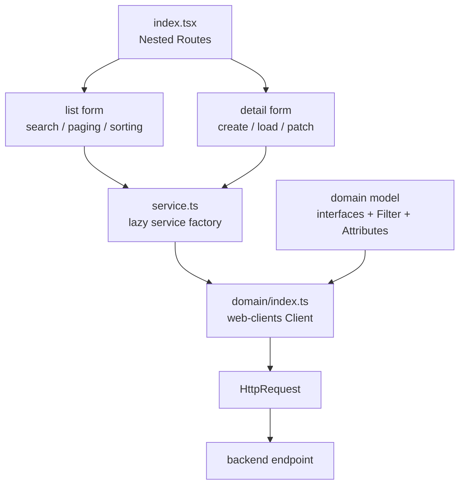

# Architecture

## Runtime overview

The project is a client-side React SPA bootstrapped by Vite.

```mermaid
flowchart TD
    HTML[index.html\nDOM shell + alert/loading/toast hosts]
    MAIN[src/main.tsx\ncreateRoot + StrictMode]
    APP[src/App.tsx\ninit() + BrowserRouter]
    INIT[Global initialization\nconfig, resources, storage, UI/loading/alert/toast]
    ROUTES[React Router route tree]
    SHELL[core/layout.tsx\nAuthenticated shell + Nav + Outlet]
    FEATURES[Feature routes and forms]
    SERVICES[Feature service factories]
    CLIENTS[axios-core + web-clients / auth clients]
    BACKEND[admin-service + auth/signup/password/OAuth services]

    HTML --> MAIN --> APP
    APP --> INIT
    APP --> ROUTES
    ROUTES --> SHELL
    SHELL --> FEATURES
    FEATURES --> SERVICES --> CLIENTS --> BACKEND
```

### Entry points

- `index.html` defines `#root`, the toast/loading/alert DOM elements, and global confirmation callbacks used by the legacy UI alert integration.
- `src/main.tsx` creates the React root and renders `<App />` inside `StrictMode`.
- `src/App.tsx` sets Axios cookie behavior, configures global shared services in `init()`, imports global CSS/fonts, and declares the route tree.
- `init()` is guarded by module-level `isInit` so the global configuration is installed once.

### Global initialization

`App.tsx` configures `uione` storage with:

- backend URLs from `src/config.ts`;
- home route `/home`;
- merged English/Vietnamese resources;
- shared loading, UI, currency, locale, alert, confirmation, toast/message, and status-name services;
- CSV handling through `DefaultCsvService`.

The app also assigns phone-code resources to `validation-core`, currency lookup to `ui-plus`, and localized confirm/alert labels to `ui-alert`.

`axios.defaults.withCredentials = true` is set globally in `App.tsx`, so cookie-based requests depend on correct browser/gateway CORS and credential configuration.

## Feature architecture

Most features keep responsibilities in separate files:



The shape varies by feature:

- `country`, `currency`, and `locale` are the clearest simple CRUD examples.
- `user` has user detail editing and an additional relationship assignment screen.
- `role` contains the permission editor and role/user assignment behavior.
- `audit-log` is a read-only search feature using `ViewSearchClient`.
- `settings` uses small hand-written clients rather than a generic CRUD client.
- `authentication` delegates to dedicated client packages (`authen-client`, `signup-client`, `password-client`).

## State and data flow

- React component state owns view state, filters, fetched lists, and form values.
- `react-hook-core` provides helpers for form state, query-string filters, pagination, sorting, and change detection.
- Feature services lazily create and cache client instances using URLs from `storage.config()`.
- `axios-core` wraps Axios requests; CRUD/search behavior is supplied by `web-clients` base classes for several domains.
- Shared runtime state such as signed-in user, token, privileges, resource maps, and locale preferences is provided by `uione`.

Many existing components mutate an object and then call its setter. This is part of the current codebase style, but new code should avoid mutating shared arrays/objects when immutable updates are straightforward and important for reliable React rendering.

## Routing and shell

Public/authentication routes are declared outside the authenticated layout. Admin feature routes are nested beneath `LayoutPage`, which renders its child route using `<Outlet />`. The shell builds its navigation from the privileges available through `uione`, not from a hard-coded feature menu.

See `ROUTES-AND-FEATURES.md` for the complete route map and `AUTHENTICATION-AND-PERMISSIONS.md` for the navigation/authorization relationship.
